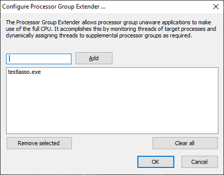

<!-- source: https://bitsum.com/apps/process-lasso/docs/algorithms/group-extender/ -->

# Processor Group Extender

Process Lasso 9.7 adds the Processor Group Extender. This novel algorithm allows processor group unaware applications to make use of the full CPU. It accomplishes this by monitoring threads of target processes and dynamically assigning threads to supplemental processor groups as required.

Processor groups are only used on systems with more than 64 logical cores. Since Windows CPU affinities are represented as 64-bit bitmasks, processor groups were introduced to extend support to more than 64 logical cores. Thus, a CPU affinity applies to only a single processor group, and each process is assigned a default processor group when it launches. A process’s threads are restricted to that default group unless they are manually assigned to other processor groups. Typically, this thread assignment is done by the application itself. Applications that are able to assign their threads to other processor groups are group aware.

Group unaware applications will therefore be limited to a single processor group, leaving CPU cores in the other group(s) underutilized. Ideally, the application developer would update their software to be group aware, but for cases where that hasn’t happened, Bitsum now has a solution! We call it the Processor Group Extender. It monitors threads of target processes and assigns excess threads to supplemental processor groups.

Note that the Processor Group Extender is only necessary, and should only be used, in situations where an application needs additional CPU cores, but is not processor group aware. Unnecessary or inappropriate use may affect the performance characteristics of an application.

## Update: Windows 11 and Windows Server 2022

Our Processor Group Extender feature is no longer necessary on Windows 11 and Windows Server 2022. The Windows CPU Scheduler now spans application threads across all processor groups by default [[MSDN](https://docs.microsoft.com/en-us/windows/win32/procthread/processor-groups)]. To take full control of how that happens, try Process Lasso’s [CPU Sets](https://bitsum.com/product-update/process-lasso-10-4-cpu-sets-and-adler-lake/) feature.

Processor Group Extender

[Watch the demo video (YouTube)](https://www.youtube.com/watch?v=LB6qWhP35KE)
