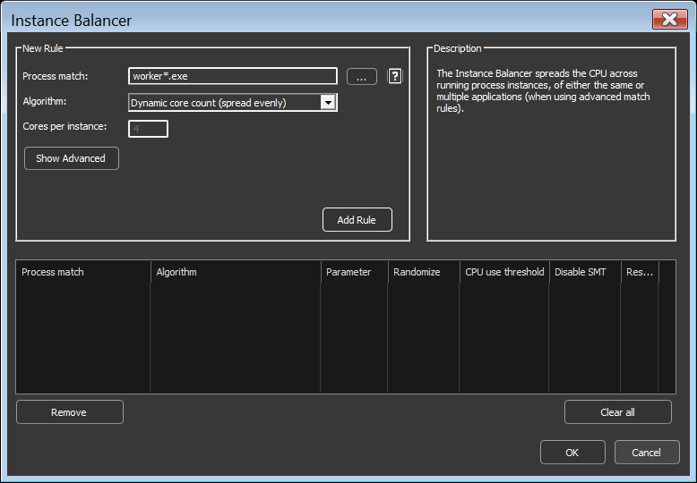
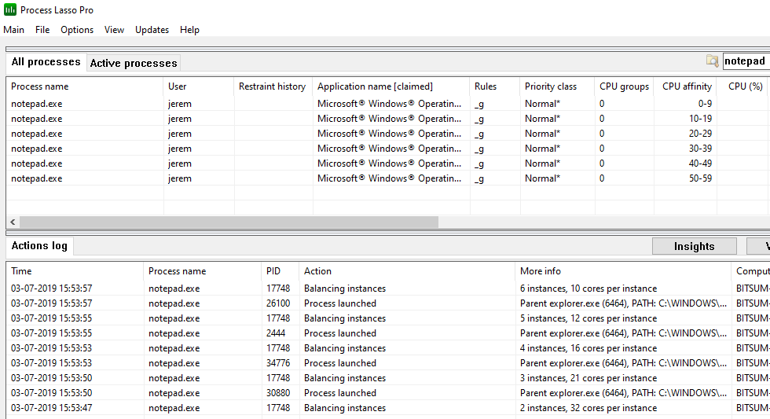

<!-- source: https://bitsum.com/apps/process-lasso/docs/algorithms/instance-balancer/ -->

# Instance Balancer

- *Menu path: ‘Options / CPU / Instance Balancer …’*

The Instance Balancer spreads CPU cores across running process instances, of either the same or multiple applications (when using [advanced match rules](../reference/process-matching.md#processmatch)). For example, if there are 4 instances of notepad.exe running on an 8 core system, each might get 2 CPU cores, depending on the rule. As the instance count of notepad.exe changes, the number of CPU cores allocated to each instance is adjusted.

When there are more instances than allotted CPU cores, instances are ‘stacked’ in a round-robin manner. When the instance count of managed applications changes by new process creation or termination, a re-balance occurs.

Instance Balancer Rule Config

## Algorithm Types

- **Equal CPUs per instance** — Distributes CPU cores evenly across matching process instances, dynamically adjusting as new instances run or terminate.
- **Fixed core count per instance** — Assigns a fixed number of CPU cores to each matching process instance.
- **NUMA** — Loads instances onto distinct NUMA nodes. The core count can be set to the number of cores each the NUMA node, or less. No instance will span multiple NUMA nodes.

## Options

- **Cores per instance** — When ‘Fixed core count per instance’ is selected, this is the number of CPU cores that will be assigned to each running instance that matches the rule.
- **Reserved cores (optional)** — This is the number of logical CPU cores per processor group to exclude from the set available to instances matching this rule. Users can use this to reserve CPU cores for other system activity. However, most often, this value should simply be 0.
- **CPU use threshold (optional)** — This is the minimum percent CPU use required before a matching process is included in the set and Instance Balanced according to the rule. This is useful if you want to exclude instances that aren’t using much CPU. This value can be 0 if you don’t want a minimum threshold.
- **Disable HT/SMT** — When checked, physical CPU cores will be selected instead of logical CPU cores. Note that when this feature is used with ‘Fixed core count’ or ‘Reserved cores’, the number of CPU cores specified for those options is still in logical units, so 2 will equal 1 assigned physical CPU.
- **Randomize** — This randomly selects CPU cores from the available set instead of sequentially assigning them to each process instance. The purpose is to better spread the load across the CPU topology. This option supports balancing across multiple processor groups, unlike the default of sequential assignment.

All children of a process can be matched with a [‘childof:’ prefix](../reference/process-matching.md#htoc-childof), such as `childof: boinc.exe`. Direct children can also be matched with RegEx, e.g. `/^([^,]*,){5}boinc\.exe.*,/`.

This feature supports [Regular Expressions for more complex and precise matching](../reference/process-matching.md#processmatch).

Instance Balancer in action

## Demo Video

[Watch the demo video (YouTube)](https://www.youtube.com/watch?v=VrE9jgovhTo)

Demo Video of Process Lasso’s Instance Balancer
