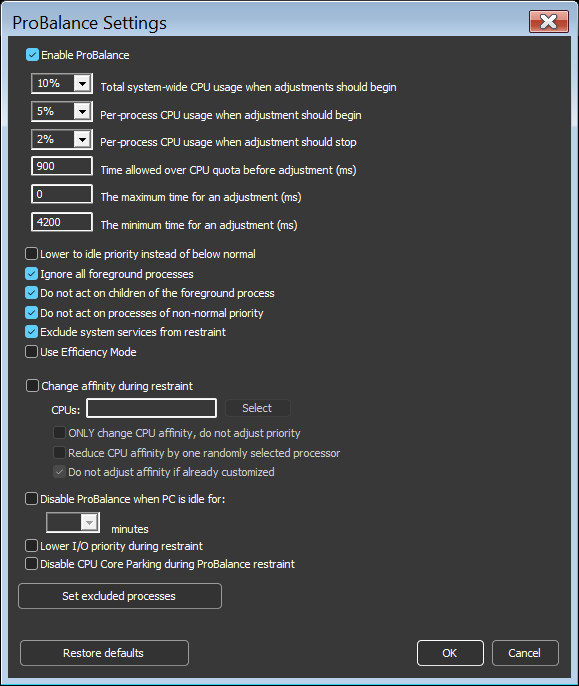
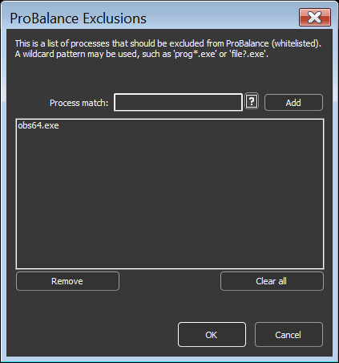

<!-- source: https://bitsum.com/apps/process-lasso/docs/algorithms/probalance/ -->

# ProBalance

*For an overview, including exclusions and how it compares with Performance Mode, see [ProBalance in Process Lasso: How it keeps Windows responsive](https://bitsum.com/how-probalance-works/).*

ProBalance (Process Balance) is Process Lasso's flagship algorithm. It keeps your system responsive during high CPU loads by temporarily lowering the priority of background processes that are monopolizing the CPU. It is enabled by default and requires no tuning.

## What Problem It Solves

The Windows CPU scheduler allows a CPU-bound process running at Normal priority to consume every available cycle. When that happens, everything else on the system contends with it for CPU time, causing lags, stalls, and freezes. Even on modern multi-core systems, a few greedy threads can noticeably degrade responsiveness.

ProBalance addresses this the same way the Linux scheduler does internally: CPU-bound processes that interfere with responsiveness are penalized, while interactive and I/O-bound processes are left alone.

## How It Works

When ProBalance detects a background process exceeding its thresholds, it temporarily lowers that process's priority class, typically to Below Normal. The adjustment is:

- **Temporary.** The original priority is restored as soon as the condition passes.
- **Marginal.** The restrained process still gets substantial CPU time; only its precedence is reduced. Tests show background jobs complete in nearly the same time while foreground responsiveness improves dramatically.
- **Selective.** Foreground processes and processes that are not causing trouble are never touched.

When ProBalance is actively restraining a process, the system tray icon turns red, the process shows *Restrained* in the Status column, and the action is recorded in the [log](../interface/logging.md). If a process never appears in the log, ProBalance has never acted on it.

To see the effect yourself, run the CPUEater demo from the [ProBalance overview page](https://bitsum.com/how-probalance-works/). It stalls an unprotected system with Normal-priority threads; with Process Lasso running, the system remains usable under the same load.

> **Tip**
>
> Do not raise your important processes to High or Real-Time priority to keep them responsive. ProBalance works from the opposite direction, by lowering the priority of the offenders, which is far safer.

## ProBalance Options

*Menu path: Options / CPU / ProBalance*

Several advanced parameters control if and when ProBalance acts, including the CPU threshold a process must exceed, how long it must exceed it, and what adjustments are applied. The defaults are the product of long refinement; be cautious changing them.

One notable option ties ProBalance to [Efficiency Mode](../rules/efficiency-mode.md): processes being restrained can additionally be placed into Efficiency Mode. This defaults to OFF because it is more heavy-handed than the stock priority adjustment.

## ProBalance Exclusions

Name-based exclusions are usually unnecessary because ProBalance's other criteria already cause it to ignore most processes that should not be acted on. If the log or Insights shows ProBalance restraining a process you want left alone, add a named exclusion.

Exclusions support [regular expressions for more complex and precise matching](../reference/process-matching.md#processmatch).

## Common Questions

**Does ProBalance slow the restrained process down?**
Only marginally. Lowering priority changes scheduling precedence, not CPU entitlement. When the system is not contended, a Below Normal process runs at full speed.

**Is it still useful on many-core CPUs?**
Yes. Responsiveness problems from CPU-hungry processes still occur on current-generation hardware, and ProBalance remains effective there.

**Should I manually set priorities on everything instead?**
No. Persistent priorities are supported, but blanket manual re-prioritization causes more problems than it solves. Let the algorithm make dynamic, temporary adjustments.

**What about boosting the foreground process instead?**
Windows already boosts the foreground application. Raising its priority further skews scheduling against the processes it depends on. Process Lasso offers [Foreground Boosting](../rules/foreground-boosting.md) as an option, but it is disabled by default for this reason.

## Related Pages

- [CPU Limiter](cpu-limiter.md), for when you want to actually cap a process's CPU use
- [Efficiency Mode](../rules/efficiency-mode.md)
- [Logging](../interface/logging.md), to review ProBalance actions
- [Foreground Boosting](../rules/foreground-boosting.md)
