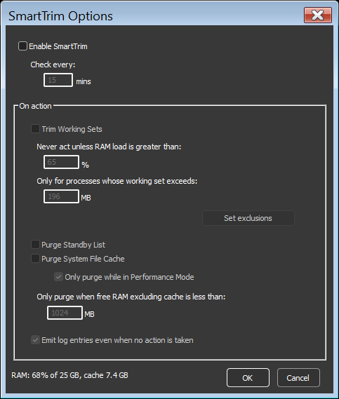

<!-- source: https://bitsum.com/apps/process-lasso/docs/algorithms/smarttrim/ -->

# SmartTrim

*For an overview, including what SmartTrim is not and suggested settings for 16 GB and 32 GB systems, see [SmartTrim: Process Lasso's memory trimming, explained](https://bitsum.com/smarttrim/).*

- *Menu path: ‘Options / Memory / SmartTrim Options …’*

SmartTrim is an intelligent memory management algorithm that can trim working sets on a per-process basis when thresholds are reached, and can also clear the system standby list (cache).

