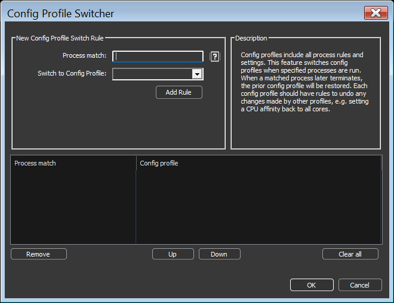

<!-- source: https://bitsum.com/apps/process-lasso/docs/power/config-profile-switcher/ -->

# Config Profile Switcher

- *Menu path: ‘File / Config Profile / Config Profile Switcher / Configure Rules…*‘

Config Profiles are named collections of all process rules and settings. This allows users to create sets of rules for specific workloads, for instance ‘Gaming’ and ‘Productivity’. Previously, these config profiles had limited utility because they couldn’t be automatically switched to when a particular process was run.

The Config Profile Switcher fills the gap by switching config profiles when specified processes are run. When a matched process later terminates, the prior config profile will be restored. Each config profile should have rules to undo any changes made by other profiles, e.g. setting a CPU affinity back to all cores.

This feature should be used sparingly. If multiple simultaneous running processes match different config switcher rules, only the oldest process will have its config enforced.

Note that process changes from the previously active config profile aren’t automatically undone. Instead, rules must be created in the other config profile(s) to counteract any previous changes. For instance, if a profile changed the CPU Affinity of notepad.exe, the other profile(s) must have CPU Affinity rules to undo that change, if desired.

The Config Profile Switcher supports wildcards and advanced [process match rules](../reference/process-matching.md#processmatch).

The *Enable the Config Profile Switcher* checkbox at the top of the dialog, or the *Enabled* item in the Config Profile Switcher submenu (also available from the system tray menu), turns the feature on or off without deleting any rules. When it is unchecked, the rules are kept but not applied, and if a rule had already switched the config profile, the prior profile is restored. The switcher is enabled by default.

Config Profile Switcher
