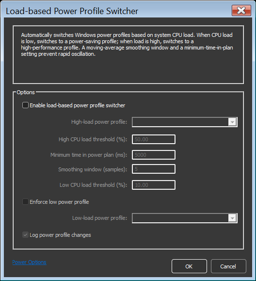

<!-- source: https://bitsum.com/apps/process-lasso/docs/power/load-based-switching/ -->

# Load-Based Power Profile Switcher

- *Menu path: ‘Options / Power / Load-Based Power Profile Switcher…*‘

The Load-based Power Profile Switcher automatically changes the active Windows power profile (power plan) based on total system CPU load. When sustained CPU load rises above a threshold you set, it switches to a high-performance power profile; when load falls back down, it steps back to a more economical profile. This lets your PC run in a power-saving state most of the time, yet automatically shift into high performance the moment a demanding workload arrives; no manual switching required.

Load-Based Power Profile Switcher

To avoid rapid back-and-forth switching (oscillation), the switcher does not react to instantaneous CPU spikes.
Instead, it evaluates a smoothed average of a minimum time between profile changes.

This feature is managed by the Process Lasso core engine (the Governor), so it works even when the GUI is closed.

## Options

**Enable load-based power profile switcher**  
Master switch for the feature. When disabled (or when Process Lasso shuts down), any power profile change the switcher made is reverted.

**High-load power profile**  
The power profile activated when the smoothed CPU load reaches the high threshold. Typically *High performance* or *Bitsum Highest Performance*.

**Low-load power profile**  
The power profile activated when the smoothed CPU load drops below the
low threshold. Typically *Balanced*. This selection only applies when *Enforce low power profile* is checked (see below).

**High CPU load threshold (%)** (default: 50)  
When the smoothed CPU load reaches or exceeds this percentage, the switcher engages the high-load profile.

**Low CPU load threshold (%)** (default: 10)  
When the smoothed CPU load falls below this percentage, the switcher steps back down. The high threshold must be greater than the low threshold; the gap between them acts as a buffer zone in which no switching occurs.

**Smoothing window (samples)**   
The number of recent CPU load samples averaged together before comparing against the thresholds. One sample is taken per engine refresh cycle (once per second at the default engine update speed), so the default of 5 means switching decisions are based on roughly the last 5 seconds of CPU load rather than any single moment.

Larger values make the switcher more resistant to brief CPU spikes and dips, at the cost of slower reaction to genuine load changes. Smaller values react faster but may switch more often. A value of 1 disables smoothing entirely, so decisions are made on instantaneous CPU load.

**Minimum time in power plan (ms)** (default: 5000)  
The minimum time that must elapse after a profile change before another change is permitted. This complements the smoothing window: smoothing filters the CPU load signal itself, while this setting rate-limits how often switches can occur.

**Enforce low power profile**  
Controls what happens when load subsides:

- *Unchecked* (default): The switcher only manages the high-load profile. When CPU load drops below the low threshold, it restores whatever power profile was active before the switch-up, then releases control so other Process
  Lasso power features (such as IdleSaver, per-process power profiles) can operate normally.
- *Checked*: The switcher actively enforces your selected low-load profile whenever load is below the low threshold, taking full control of the power profile in both directions.

**Log power profile changes**  
When checked, each profile change made by the switcher is recorded in the Process Lasso log.

## Interaction with Other Power Features

While the switcher is holding the high-load profile, it takes precedence over IdleSaver, Performance Mode, and application power profiles so they don’t fight over the active plan. In the default (non-enforcing) mode, those features regain control as soon as the switcher steps back down.
