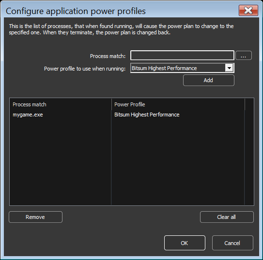

<!-- source: https://bitsum.com/apps/process-lasso/docs/power/power-profiles/ -->

# Application Power Profiles

- *Menu path: ‘Options / Power / Application Power Profiles …’*

The user can create rules to that cause the system to enter the chosen power plan when specified processes are running. When they terminate, the system is returned to the previous power plan. This lets users target their system power plan to specific applications. You can do this by right-clicking on a process, using the ‘*Application power profile*‘ submenu, or by the menu option at ‘*Options / Power / Application Power Profiles …”*.

## Start with (Base) Power Profile

- *Menu path: ‘Options / Power / Start Process Lasso with Power Profile …’*

This option allows you to specify the power plan that the system should be in both when Process Lasso first starts (before any rule enforcement), and when there are no power rules active. It is useful to prevent cases where the system ends up in an undesired power plan due to conflicting simultaneously active power rules or external changes to the power plan.
