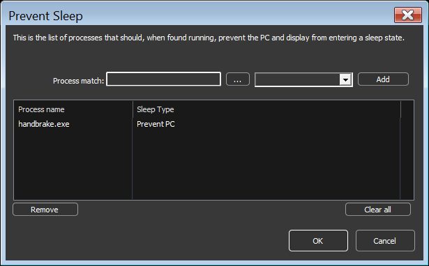

<!-- source: https://bitsum.com/apps/process-lasso/docs/rules/anti-sleep/ -->

# Anti-Sleep Processes

- *Menu path: ‘Options / Power / Keep Awake …’*

The user can prevent the PC and display from entering a sleep or hibernate state by adding them to the ‘anti-sleep’ list. This can be done by right-clicking on a process, using the ‘When running’ menu, or by using application menu option at ‘Options / Configure Anti-Sleep processes …’.

