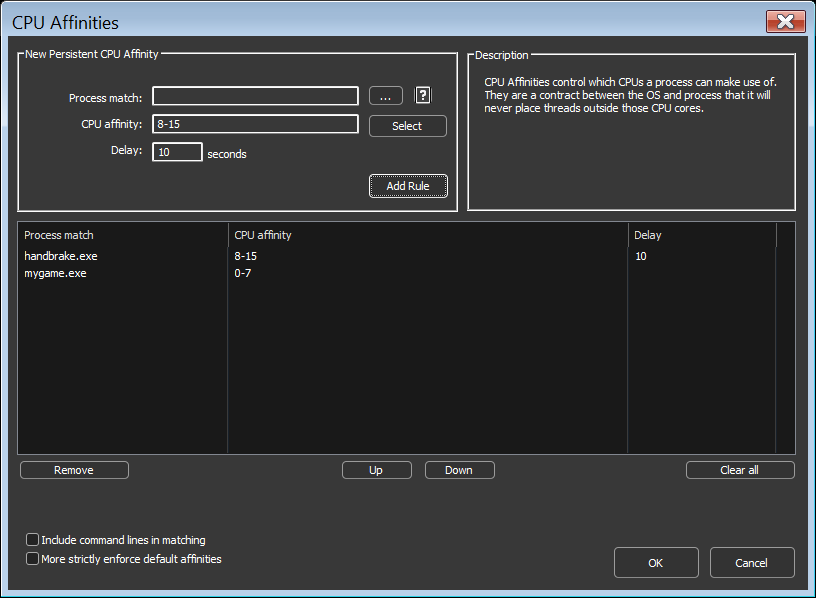

<!-- source: https://bitsum.com/apps/process-lasso/docs/rules/cpu-affinities/ -->

# CPU Affinities

A CPU affinity controls which CPU cores a process is allowed to use; its threads will only ever be scheduled onto that set of cores.

## When to Use It

- Dedicate specific cores to a game, application, or service, and keep other software off them.
- Cap the maximum possible CPU consumption of a process by shrinking the set of cores available to it.
- Keep a process within one CCD or cache domain on multi-die CPUs. See [AMD Ryzen X3D CPUs: Keeping Games on the 3D V-Cache CCD](https://bitsum.com/amd-x3d-ccd-affinity/).
- Keep a process on the P-cores, or a background job on the E-cores, of an Intel hybrid CPU. See [Intel Hybrid CPUs: Scheduling on P-Cores and E-Cores](https://bitsum.com/intel-hybrid-p-cores-e-cores/).

If you want to reduce a process's CPU use only *when it misbehaves*, rather than permanently, use the [CPU Limiter](../algorithms/cpu-limiter.md#cpulimiter) instead: it constrains the affinity dynamically and restores it afterward. If you want a softer preference the scheduler can override when needed, use [CPU Sets](cpu-sets.md#cpusets).

## How to Set It

Right-click a process and choose *CPU Affinity*, either for the current instance or under the *always* submenu for a persistent rule. Persistent rules can be managed together at *Options / CPU / CPU Affinities*.

### The Delay Field

The optional *Delay* field applies the affinity only after the specified number of seconds from process startup. This helps with games and applications that are sensitive to affinity changes during their startup phase, and can also be used deliberately to give a process the full CPU while loading before restricting it.

## Disable SMT or Hyper-Threading

The *CPU Affinity* context menu contains an item that disables SMT (Hyper-Threading) for a process by enforcing an affinity containing only one logical core from each physical core. On most CPU models this produces an alternating affinity pattern.

## Caveats

- **Systems with more than 64 logical cores:** Windows restricts CPU affinities to a single processor group. Process Lasso makes a best effort to move threads of multi-group processes to your chosen affinity, but new threads are not automatically constrained unless the affinity is continuously reapplied, which Process Lasso does for persistent rules. Consider [CPU Sets](cpu-sets.md) instead, which have no multi-group restrictions. See also the [Processor Group Extender](../algorithms/group-extender.md).
- **Anti-cheat protected games** block direct affinity changes. See [working with anti-cheat systems](../help/anti-cheat.md) for the launcher-inheritance workaround.

## Related Pages

- [CPU Sets](cpu-sets.md)
- [CPU Limiter](../algorithms/cpu-limiter.md)
- [System Reserved CPU Sets](reserved-cpu-sets.md)
- [Anti-Cheat Systems](../help/anti-cheat.md)
- [When CPU Affinity Matters](https://bitsum.com/tips-and-tweaks/when-cpu-affinity-matters/)
