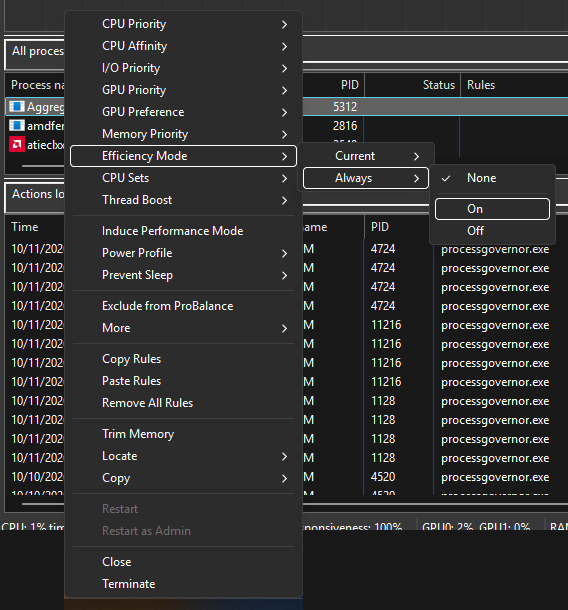
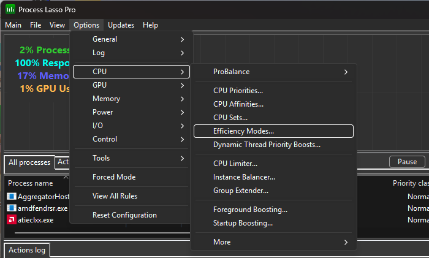
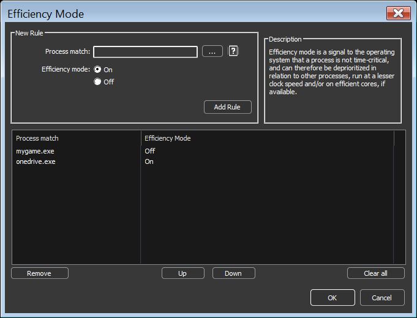
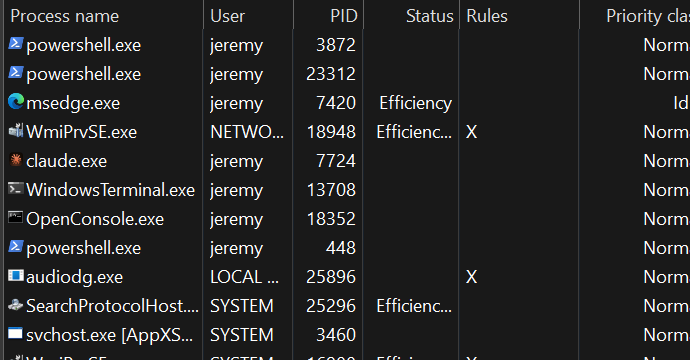

<!-- source: https://bitsum.com/apps/process-lasso/docs/rules/efficiency-mode/ -->

# Efficiency Mode

Efficiency Mode is a Windows signal that a process is not time-critical, so the OS may deprioritize it, run it at lower clock speeds, or schedule it onto efficiency cores (E-cores) if available. Windows provides no way to make the setting stick; Process Lasso lets you persist Efficiency Mode ON or OFF for specific processes.

> **Note**
>
> Requires Windows 11 or later. On hybrid CPUs (such as Intel P/E-core designs), Efficiency Mode strongly influences which cores a process runs on.

## When to Use It

- **Force OFF** for performance-critical processes that Windows inappropriately classifies as efficient, keeping them off E-cores and exempt from other energy-saving actions.
- **Force ON** for background processes whose responsiveness you do not care about, reducing their power draw and their interference with foreground work.

For the other ways to keep a program on the P-cores, and which CPUs have E-cores, see [Intel Hybrid CPUs: Scheduling on P-Cores and E-Cores](https://bitsum.com/intel-hybrid-p-cores-e-cores/).

## How to Set It

Right-click a process and use the context menu to set Efficiency Mode for the current instance only, or under the *always* submenu to create a persistent rule.

Persistent rules can be managed in one place at *Options / CPU / Efficiency Modes*.

## How It Is Displayed

- The **Status** column shows *Efficiency* for processes currently in Efficiency Mode. (Statuses shown there also include *Restrained*, applied by ProBalance, and *Suspended*.)
- The **[Rules](../interface/rules-column.md)** column shows **E** for an Efficiency Mode always ON rule and **e** for always OFF.

## Caveats and Interactions

- Some applications mark individual *threads* as efficient rather than the whole process. Process Lasso does not currently display thread-level classification, but an Efficiency Mode OFF rule ensures no threads in the process are classified as efficient.
- [ProBalance](../algorithms/probalance.md#ooc_options) has an option to place processes into Efficiency Mode while they are being restrained. It defaults to OFF because it is more heavy-handed than ProBalance's normal priority adjustment.

## Related Pages

- [CPU Affinities](cpu-affinities.md), a hard constraint on which cores a process may use
- [CPU Sets](cpu-sets.md), a soft core preference
- [ProBalance](../algorithms/probalance.md)
