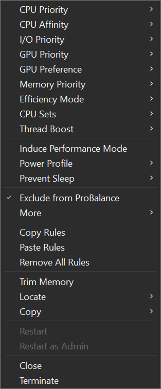

<!-- source: https://bitsum.com/apps/process-lasso/docs/rules/ -->

# Automation

Do you need to:

- Set permanent CPU affinities, priorities, or other process settings?
- Change power plans when a specific application is running?
- Constrain a process once it exceeds a certain level of CPU use?

These are some of the many automation capabilities of Process Lasso! Take control of your PC through your own manual rules or let Process Lasso’s automated [algorithms](../algorithms/index.md#algorithms) do it for you.

> **Tip**
>
> Rules you create are shown in shorthand in the process list's Rules column. See the [Rules column legend](../interface/rules-column.md) for what each symbol means.

Wildcards are accepted in most rules, along with Regular Expressions for more complex matching. [Read more here](../reference/process-matching.md#processmatch). To target every process launched by an application, use a [`childof:` match](../reference/process-matching.md#htoc-childof), such as `childof:steam.exe`.

Process Lasso’s automation capabilities include:

- **[CPU Affinities](cpu-affinities.md#default_affinities)** — Set permanent CPU affinities so that processes run on the desired set of CPUs every time they launch.
- **[CPU Sets](cpu-sets.md#cpusets)** — A ‘softer’ form of CPU Affinities that are more like preferred cores.
- **[Priority Classes](priorities.md#default_priorities)** — Set permanent CPU, GPU, I/O, and memory priorities so that processes run at the desired priorities every time they launch.
- **[Thread Priority Boosts](priorities.md#boost)** — Set Dynamic Thread Priority Boosting enabled or disabled for processes.
- **[Efficiency Mode](efficiency-mode.md#efficiency_mode)** — Set and persist per-process Efficiency Mode settings.
- **[Disallowed Processes](auto-terminate.md#auto_terminate)** — Immediately terminate any matched process, by your criteria.
- **[Keep Running](keep-running.md#keep_running)** — Automatically restart select processes when they terminate.
- **[IdleSaver](../power/idlesaver.md#idlesaver)** — Conserve energy when your PC is idle by switching to a more frugal power plan.
- **[Power Plan Automation](../power/power-profiles.md#application_power_profiles)** — Switch power plans while idle ([IdleSaver](https://bitsum.com/idlesaver/)) or when specified processes are running.
- **[Prevent Sleep](anti-sleep.md#anti_sleep) (Keep Awake)** — Process Lasso can prevent your PC from sleeping for a specified amount of time, or when select processes are running.
- **[Disable Hyper-Threading or SMT](cpu-affinities.md#smt)** — Dynamically disable Hyper-Threading or SMT on a per-process basis.
- **[Foreground Boosting](foreground-boosting.md#foreground-boosting)** — Dynamically increase the priority of the application that has input focus.
- **[Startup Boost](startup-boost.md#startup_boost)** — Temporarily raise the priority class of processes for a period of time after they are started.
- **[System Timer Resolution](timer-resolution.md#system-timer-resolution)** — Adjust and persist the system timer resolution in up to 0.5ms increments.
- **[Multi-select Operations](../interface/all-processes.md#multi_context)** — Perform an operation like terminate on multiple processes at once!
- **[Advanced Watchdog Rules](watchdog.md#watchdog)** — Create “if, then” rules to perform an action when matched process(es) reach a certain threshold of resource consumption or other criteria.
- **[Configuration Profiles](../power/config-profile-switcher.md#config-profile-switcher)** — Profiles allows for creation and use of multiple rule configurations.
- **More…** — Process Lasso contains numerous other features and functions. Explore them for yourself!

Process context menu
