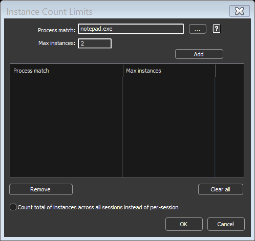

<!-- source: https://bitsum.com/apps/process-lasso/docs/rules/instance-limits/ -->

# Instance Count Limits

- *Menu path: ‘Options / Control / Instance Count Limits …’*

The user can limit the number of instances of a process allowed to be running at the same time (per user session) with this dialog. New instances of processes will be terminated if they match a pattern here and the number of instances is already equal to, or greater than, the instance count limit.

Instance Count Limiter
