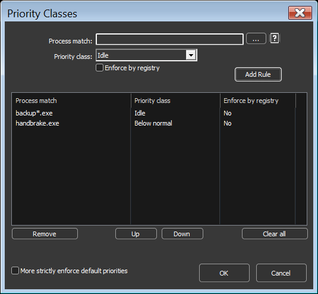
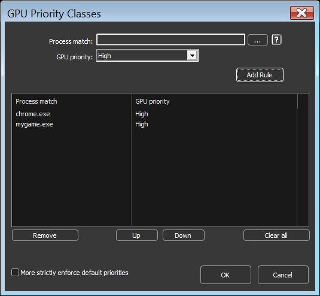
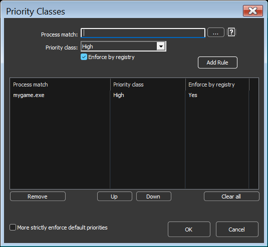
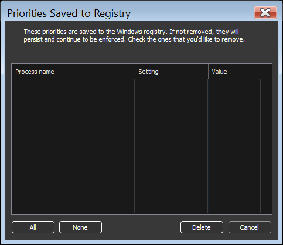
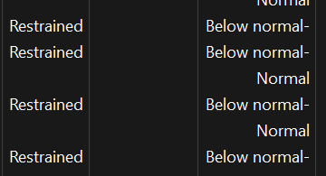

<!-- source: https://bitsum.com/apps/process-lasso/docs/rules/priorities/ -->

# Priorities

## CPU Priority Classes

- *Menu path: ‘Options / CPU / CPU Priorities …’*

Priority classes, sometimes referred to as ‘CPU Priorities’ in Process Lasso, are available to keep applications running at specific priorities.

It is generally best to focus on lowering priorities of background and unimportant processes, rather than raising the priorities of important ones. This is simply due to the design of Windows. The [ProBalance](../algorithms/probalance.md#probalance) algorithm applies these adjustments to CPU heavy background processes dynamically.

Priority classes available in Windows are:

- Real-Time
- High
- Above Normal
- Normal
- Below Normal
- Idle

Normally setting the priority class is sufficient, but I/O priorities and memory priorities can also be set using their corresponding menu items and dialogs.

The menu item “Windows dynamic thread priority boosts enabled” can be checked to disable that native Windows feature. This is the same setting reflected in the “[Thread Boost](priorities.md#boost)” context menu item.

## GPU Priority Classes

- *Menu path: ‘Options / GPU / GPU Priorities …’*

With AI workloads increasingly competing for GPU resources, we felt it important to add GPU priority support to Process Lasso. Now users can ensure that their most important GPU workloads, such as gameplay, are prioritized.

Available GPU priority classes are the same as CPU priority classes:

- Real-time
- High
- Above Normal
- Normal
- Below Normal
- Idle

A new GPU priority column is shown in the process lists that indicates the GPU priority class.

Users can set GPU priority rules via the process context menu or by menu item “Options / GPU / GPU Priorities…”.

Unfortunately, GPU priority classes are not inherited by child processes and “Enforce by Registry” (IFEO) methods are not supported. This means that processes protected by anti-cheat systems won’t be able to have their GPU priorities set. In these cases, we instead recommend focusing on ensuring other processes with GPU workloads are set to below normal or idle priorities.

## I/O Priorities

I/O priorities provide a hint to the OS about the relative importance of I/O for a process. However, no guarantee is made about prioritization over other I/O, or specific QoS parameters.

- High
- Normal
- Low
- Very Low

## Memory Priorities

Memory priorities provides a hint to the OS about the relative importance of memory pages when they are being paged out.

> … [one] should lower the default memory priority of threads that perform background operations or access files and data that are not expected to be accessed again soon. For example, a file indexing application might set a lower default priority for the process that performs the indexing task.
>
> **Memory priority** helps to determine how long pages remain in the [working set](https://learn.microsoft.com/en-us/windows/desktop/Memory/working-set) of a process before they are trimmed. A process’s memory priority determines the default priority of the physical pages that are added to the process working set by the threads of that process. When the memory manager trims the working set, it trims lower priority pages before higher priority pages. This improves overall system performance because higher priority pages are less likely to be trimmed from the working set and then trigger a page fault when they are accessed again.
>
> [SetProcessInformation function (processthreadsapi.h) – Win32 apps | Microsoft Learn](https://learn.microsoft.com/en-us/windows/win32/api/processthreadsapi/nf-processthreadsapi-setprocessinformation)

- Normal
- Below Normal
- Medium
- Low
- Very Low

## Enforce By Windows Registry

Enforce by registry uses the [Windows Image File Execution Options](https://learn.microsoft.com/en-us/previous-versions/windows/desktop/xperf/image-file-execution-options) feature to save the priority to the registry so that every time that process is launched it will start with the chosen priority. Since the priority is applied by Windows at the time of process creation, this method works on processes that are otherwise inaccessible, such as those protected by anti-cheat systems. The disadvantage is that these settings persist in the registry, so they may go unnoticed and forgotten about if not managed with a tool like Process Lasso.

This feature supports priority classes, I/O priorities and memory priorities. CPU affinities and other rule types are not supported.

Use of this method is benign so is not known to cause any alerts within anti-cheat systems. The priority restriction enforced by anti-cheat systems is more a side-effect of the process protection, rather than one of the aims.

### Setting Registry Enforced Priorities

There are two ways to set a registry enforced priority:

- In the rule configuration dialogs for [CPU priority classes](priorities.md#default_priorities), I/O priorities, and memory priorities, check ‘Enforce by registry’ when adding the rule.

- In the process context menu, under ‘CPU Priority / Always’ (or ‘I/O Priority / Always’, ‘Memory Priority / Always’), toggle ‘Enforce by Windows Registry’. When checked, the process’s ‘Always’ priority for that type is stored in the registry instead of the Process Lasso configuration; unchecking it converts the rule back to a normal configuration rule.

Note that priorities enforced by registry require the process be restarted to take effect, since they are applied by Windows when the process is created.

### Reviewing Registry Enforced Priorities

- *Menu path: ‘Options / General / View Priorities Saved to Registry …’*

Priorities saved to the registry can be reviewed and removed in this dialog.

Priorities saved to the registry for review and cleanup

## Thread Boost

- *Menu path: ‘Options / CPU / Dynamic Thread Priority Boosts …’*

[Dynamic thread priority boosting](https://learn.microsoft.com/en-us/windows/win32/procthread/priority-boosts) is a native feature of Windows that temporarily boosts the priority of threads when they wake to resume work. It defaults to ON for new processes and should normally remain ON.

When dynamic thread priority boosts are disabled for a process, the priority class name will have a hyphen appended to it. You can toggle boosts on or off using the “Thread Boost” context menu or “Options / CPU / Dynamic Thread Priority Boosts…”.

Dynamic Thread Priority Boost disabled is indicated by hyphen.
