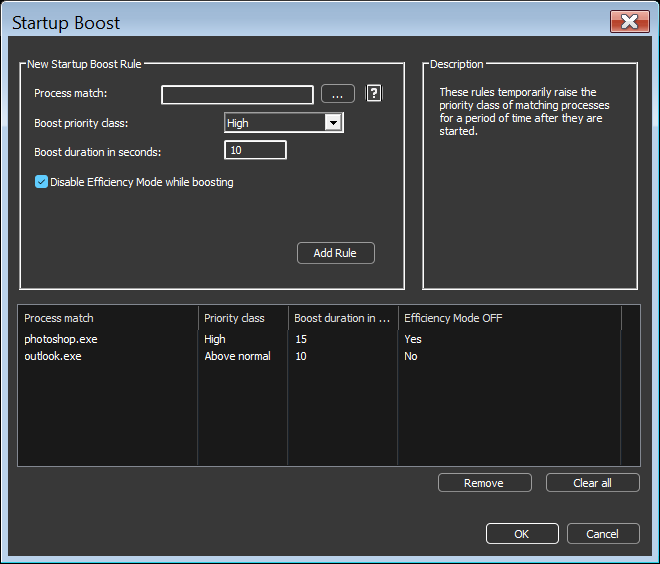

<!-- source: https://bitsum.com/apps/process-lasso/docs/rules/startup-boost/ -->

# Startup Boost

- *Menu path: ‘Options / CPU / Startup Boosting…’*

Startup Boost temporarily raises the priority class of matching processes for a period of time after they are started. This gives new processes a brief scheduling advantage while they load, improving launch responsiveness of applications that do a lot of work at startup.

Each rule consists of:

- **Process match**: The process(es) the rule applies to. Wildcards and Regular Expressions are supported, as with other rules. See [Process Matching](../reference/process-matching.md#processmatch).
- **Boost priority class**: The priority class applied during the boost, either *Above normal* or *High*.
- **Boost duration in seconds**: How long the boost lasts, from 1 to 3600 seconds.
- **Disable Efficiency Mode while boosting**: When checked, [Efficiency Mode](efficiency-mode.md#efficiency_mode) is turned off for the process during the boost so that it is not constrained to efficiency cores while it loads.

When the boost period ends, the process priority class is restored to its prior value. If the priority class was changed by some other actor while the boost was active, it is left as-is.

You can also create a Startup Boost rule for a specific process by right-clicking it in the process list and choosing ‘More / Startup Boost…’.

Processes with a Startup Boost rule show an ‘S’ in the [Rules column](../interface/rules-column.md). Boost activity is recorded in the [log](../interface/logging.md) as ‘Startup boost applied’ and ‘Startup boost ended’ events. These entries can be turned off together with **Options > Log > Log Startup Boost**.
