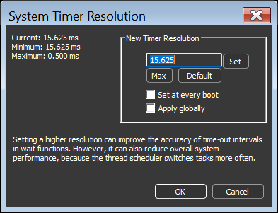

<!-- source: https://bitsum.com/apps/process-lasso/docs/rules/timer-resolution/ -->

# System Timer Resolution

- *Menu path: ‘Tools / System Timer Resolution’*

This is a built-in tool to persist adjustments to the System Timer Resolution, in up to 0.5ms increments. Other tools on the market didn’t allow the user to persist this change, thus required it be manually re-applied at every boot. We can’t speak to general efficacy of this tweak, although have no doubt there are cases where it is desirable. Importantly, starting with Windows 10 2004, for processes that do not themselves request a specific timer resolution, this adjustment will have no impact unless you have checked ‘Apply globally’.

From MSDN:

> Prior to Windows 10, version 2004, this function affects a global Windows setting. For all processes Windows uses the lowest value (that is, highest resolution) requested by any process. Starting with Windows 10, version 2004, this function no longer affects global timer resolution. For processes which call this function, Windows uses the lowest value (that is, highest resolution) requested by any process. For processes which have not called this function, Windows does not guarantee a higher resolution than the default system resolution.
>
> Starting with Windows 11, if a window-owning process becomes fully occluded, minimized, or otherwise invisible or inaudible to the end user, Windows does not guarantee a higher resolution than the default system resolution. See [SetProcessInformation](https://learn.microsoft.com/en-us/windows/desktop/api/processthreadsapi/nf-processthreadsapi-setprocessinformation) for more information on this behavior.
>
> Setting a higher resolution can improve the accuracy of time-out intervals in wait functions. However, it can also reduce overall system performance, because the thread scheduler switches tasks more often. High resolutions can also prevent the CPU power management system from entering power-saving modes. Setting a higher resolution does not improve the accuracy of the high-resolution performance counter.
>
> [timeBeginPeriod function (timeapi.h) – Win32 apps | Microsoft Learn](https://learn.microsoft.com/en-us/windows/win32/api/timeapi/nf-timeapi-timebeginperiod)
