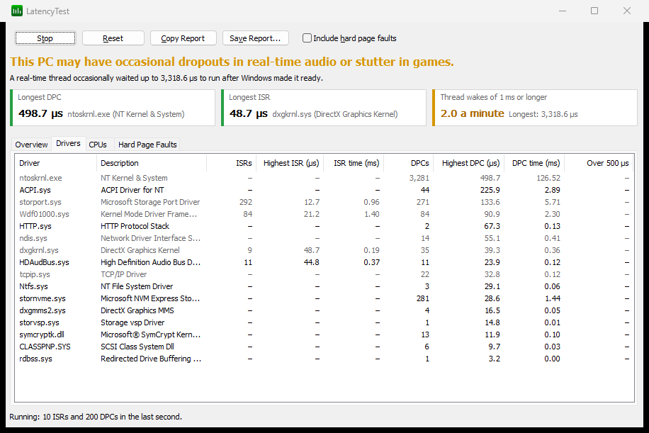

<!-- source: https://bitsum.com/apps/process-lasso/docs/tools/latencytest/ -->

# LatencyTest

- *Menu path: ‘Options / Tools / LatencyTest’*

> **Beta**
>
> LatencyTest is in the Process Lasso beta versions (18.5.0.13 and later) and arrives in the next final release. The stand-alone [LatencyTest](https://bitsum.com/latencytest/) is a free beta too.

LatencyTest finds the drivers behind audio dropouts, crackles and stutter in games. It measures how long each driver's interrupt routines run, and how long a real-time thread waits to run after Windows wakes it. It then tells you in one sentence whether the PC is likely to have trouble, and which driver is responsible.

LatencyTest is included in the free edition. It needs administrator rights, like the rest of Process Lasso, and installs no driver of its own: It reads the kernel's own trace events through a private trace session.

LatencyTest runs as its own program (LatencyTest.exe), in Process Lasso's language and theme, and keeps running after Process Lasso's window closes. Only one LatencyTest runs at a time. It is also available on its own, free, as an installer or a portable zip, for PCs without Process Lasso: See [LatencyTest](https://bitsum.com/latencytest/) on bitsum.com.

LatencyTest only measures while its window is visible. Minimizing the window pauses the test, restoring it resumes the test, and closing the window ends the trace session, so it adds no overhead when you are not looking at it.

## Running a Test

1. Open ‘Options / Tools / LatencyTest’. The test starts as soon as the window opens.
2. Use the PC the way you do when the problem happens: Play the game, run the audio work, or start the download or copy that seems to cause it. Leave the test running for at least a few minutes, since many problems come and go.
3. Read the verdict at the top of the window, and the sentence under it that names the cause.
4. Look at the **Drivers** tab to see which drivers ran the longest.

**Stop** pauses the test and keeps the results, **Start** continues it, and **Reset** clears the results.

## The Verdict

The verdict is one of three sentences:

- **Good:** ‘This PC should handle real-time audio and games without dropouts or stutter.’
- **Warning:** ‘This PC may have occasional dropouts in real-time audio or stutter in games.’
- **Bad:** ‘This PC is likely to have dropouts in real-time audio and stutter in games.’

The sentence under it explains whichever measurement decided the verdict. It names the driver with the longest interrupt service routine (ISR) or deferred procedure call (DPC), or says how often real-time threads waited too long.

| Measurement | Warning | Bad |
| --- | --- | --- |
| Longest single ISR or DPC | 500 µs or longer | 2,000 µs (2 ms) or longer |
| Thread wakes of 1 ms or longer | More than 6 a minute |  |
| Thread wakes of 3 ms or longer | Any | More than 6 a minute |

ISRs and DPCs are judged by the longest single one, because one routine that runs too long is a problem with that driver. Thread wakes are judged by how often they are slow: An idle PC wakes a sleeping core late now and then, and an isolated slow wake rarely causes an audible dropout. During the first minute, the rates are counts.

## What LatencyTest Measures

- **Interrupt service routines (ISRs):** The code a driver runs the moment its device raises an interrupt. Nothing else runs on that CPU until it finishes, so a long ISR delays everything, including audio.
- **Deferred procedure calls (DPCs):** The follow-up work a driver schedules from its ISR, such as processing received network packets. DPCs also run before any thread on that CPU, so long DPCs are the most common cause of audio dropouts.
- **Thread wake latency:** A high-priority thread waits on a 1 ms timer, the way an audio thread waits for its next buffer. LatencyTest measures the time from Windows making the thread ready to the thread actually running.
- **Hard page faults (optional):** With **Include hard page faults** checked, LatencyTest also counts, per process, how often memory had to be read back from disk. A process that keeps faulting can stall, even when every driver is fine. Checking or unchecking the box restarts the trace session.

ISR and DPC times are exclusive, like Windows Performance Analyzer's: When an ISR interrupts a DPC on the same CPU, its time counts only for the ISR's driver.

## The Tabs

Above the tabs, three tiles show the numbers that decide the verdict: The longest DPC and the longest ISR, each with its driver, and how many thread wakes a minute took 1 ms or longer. The colored edge of each tile shows its own Good, Warning or Bad.

- **Overview:** A graph of the highest ISR, DPC and thread wake latency for each second of the last five minutes, with the Warning and Bad ranges shaded, and a summary of the whole test. The graph's scale fits the last minute; turn the mouse wheel over the graph to zoom the scale in or out, and double-click the graph (or click **Reset**) to return to the automatic scale.
- **Drivers:** Every driver that ran ISRs or DPCs, with counts, the longest single routine, the total time, and how many ran longer than 500 µs. Times over the Warning or Bad thresholds are colored, the driver that decided the verdict is highlighted, and [framework drivers](latencytest.md#latencytest_framework_drivers) are dimmed. Click a column header to sort.
- **CPUs:** The same counts per logical processor, and the highest thread wake on each. On hybrid CPUs, the **Core type** column shows performance and efficiency cores.
- **Hard Page Faults:** Processes with hard page faults, when the option is checked.

## Fixing a Problem Driver

When one driver stands out in the **Drivers** tab:

1. Update that driver, preferably from the PC or device maker's website rather than Windows Update. Network, Wi-Fi, graphics, audio and storage drivers are the usual causes.
2. Right-click the driver and choose **Interrupt Settings...** (or double-click it). This opens Interrupt Affinity Policy with that driver's device selected, so you can move its interrupts to CPUs that your game or audio software does not use.
3. If the device is not needed, disable it in Device Manager and run the test again to confirm the difference.

Right-click a driver for **Open File Location** and **Properties** too.

### Framework Drivers

Some Windows drivers run interrupt and DPC routines for other drivers, so their time cannot be tied to one device: Wdf01000.sys, ndis.sys, storport.sys, dxgkrnl.sys, tcpip.sys, ntoskrnl.exe, hal.dll, ucx01000.sys, usbport.sys, hidclass.sys, ks.sys, portcls.sys, ataport.sys and scsiport.sys. When one of these is at the top of the list, the cause is usually a device whose driver uses it:

- **ndis.sys and tcpip.sys:** A network or Wi-Fi adapter. Try the adapter maker's latest driver, or test with the adapter disabled.
- **Wdf01000.sys:** Many modern drivers are built on this framework, including some network adapters. Look at which devices were busy during the test.
- **storport.sys:** A storage controller or drive.
- **dxgkrnl.sys:** A graphics adapter.

**Interrupt Settings...** explains this when you choose it for a framework driver.

## Reports

**Copy Report** copies a text report of the verdict, the summary and every table to the clipboard, ready to paste into a forum post or a support request. **Save Report...** saves the same report as a text file, or as a JSON file for scripts.

## Notes

- On Windows 8 and later, LatencyTest uses its own private trace session, so it can run alongside LatencyMon, Windows Performance Recorder and xperf. Windows 7 has only one kernel trace session: If another tool is using it, LatencyTest says so and leaves that tool's session alone.
- A remote desktop session raises thread wake latency on some PCs. For the most representative results, run the test at the PC itself.
- Results are only as good as the workload: A test of an idle PC says little about a problem that happens during a game.
