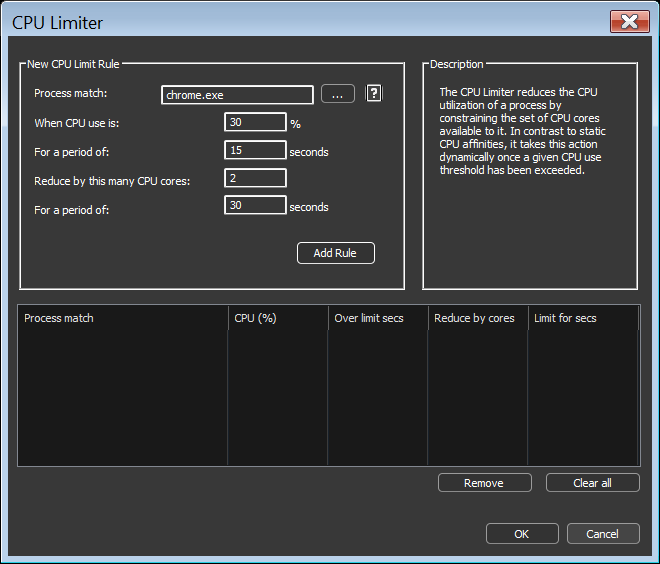
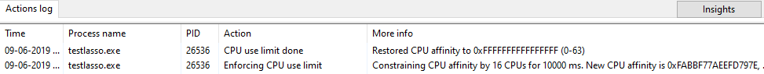

<!-- source: https://bitsum.com/apps/process-lasso/docs/algorithms/cpu-limiter/ -->

<a id="cpulimiter"></a>

<a id="cpu-limiter"></a>

# CPU 限制器

*菜单路径：选项 / CPU / CPU 限制器*

CPU 限制器通过临时约束进程的 CPU 相关性来动态降低其 CPU 使用率。当匹配的进程在设定时段内持续超过 CPU 阈值时，会在设定时长内从其相关性中移除若干核心，从而为该进程可能消耗的 CPU 设定上限。例如在 4 核系统上移除 1 个核心，就把进程限制在总 CPU 的 75%。

<a id="when-to-use-it"></a>

## 适用场景

当确实需要降低某个进程的原始 CPU 消耗时，就该用 CPU 限制器，例如：

- 远程桌面服务（RDS）主机，其中某个用户的进程不应挤占其他人。
- 占用系统资源份额过大的非关键后台进程。

> **不是万能药**
>
> CPU 使用之所以发生，是因为进程在干活；限制它只会让那些活干得更慢。如果您的目标是在高负载下保持系统响应，而不是让 CPU 数字变好看，[ProBalance](probalance.md) 能在不降低 CPU 使用的情况下做到这一点。

<a id="how-it-works"></a>

## 工作原理

您创建的规则指明对哪些进程、在什么条件下动作。每条规则定义：

- **进程匹配**，支持通配符、用户名与[正则表达式](../reference/process-matching.md#processmatch)
- **阈值**：触发规则的 CPU 百分比
- **持续时段**：进程必须超过阈值多久
- **限制核心数**：从其相关性中移除多少核心
- **生效时长**：限制持续多久；填 0 表示相关性更改无限期保持



被移除的核心从进程原始相关性中随机选取。生效时长结束后，原始 CPU 相关性会被恢复。限制器的动作会记录到[日志](../interface/logging.md)。



<a id="example"></a>

## 示例

假设 Chrome 有时会吃掉所有可用 CPU，但您不想要一个固定的相关性——那也会妨碍它合理的短时突发。可以建立这样一条规则：

```
chrome.exe, after 15 seconds over 30%, restrict by 2 cores for 30 seconds
```

若只想针对特定用户的实例，在匹配项后附加用户名：

```
chrome.exe:johnny
```

通配符在进程名与用户名中都可用：

```
fire*.exe:user*
```

若未指定用户，规则匹配任意用户。

<a id="cpu-limiter-vs-the-watchdog"></a>

## CPU 限制器与看门狗

用两条[看门狗](../rules/watchdog.md)规则也能达到类似效果：一条在超过阈值时约束相关性，另一条负责恢复。CPU 限制器配置更简单，而且不同于看门狗里静态定义的相关性，它会恢复每个进程各自原本的相关性。

<a id="demo-video"></a>

## 演示视频

[观看演示视频（YouTube）](https://www.youtube.com/watch?v=vn33iE_8yaI)

<a id="related-pages"></a>

## 相关页面

- [ProBalance](probalance.md)：在不限制 CPU 使用的前提下维持响应能力
- [CPU 相关性](../rules/cpu-affinities.md)：静态的核心限制
- [硬性节流](hard-throttling.md)
- [进程匹配](../reference/process-matching.md)
