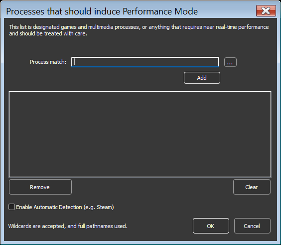
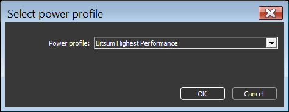

<!-- source: https://bitsum.com/apps/process-lasso/docs/algorithms/performance-mode/ -->

# 性能模式

*若需总体介绍，包括何时使用、它与 ProBalance 及 Windows 11 效率模式的对比，请参阅 [Process Lasso 中的性能模式（Bitsum 最高性能电源计划）](https://bitsum.com/bhp/)。*

- *菜单路径：「选项 / 电源 / 性能模式」*

性能模式是一种状态，会触发一组动作以确保最大性能。用户可以指定某些进程在运行时「触发性能模式」，也可以开启自动游戏检测（新安装时默认关闭）。

性能模式所执行的动作目前限于：切换当前电源计划（配置方案），以及把目标进程从 ProBalance 中排除——不过考虑到 ProBalance 默认的排除条件（即前台进程），后者通常并无必要。但在将来，可能会出现其他动作，例如调整 ProBalance 算法。因此，相比简单的应用电源计划规则，我们更推荐使用性能模式。

用户可以通过右键单击进程并勾选「*触发性能模式*」菜单项，或使用应用程序菜单中的「*选项 / 电源 / 性能模式*」来指定某个进程为「高性能」进程。

进程上下文菜单中的触发性能模式项

用户可以为性能模式选择其他电源计划，而不使用默认的 Bitsum 最高性能。

为性能模式选择其他电源计划
