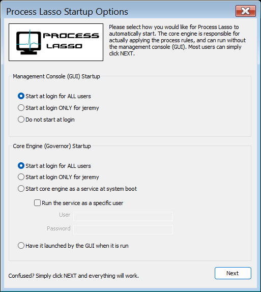

<!-- source: https://bitsum.com/apps/process-lasso/docs/deployment/auto-start/ -->

# 自动启动行为

在菜单项「*选项 / 常规 / 配置启动*」中，用户可以配置 Process Lasso 的图形界面以及（单独配置的）核心引擎（Governor 服务）如何启动。规则由 Governor 执行，无需图形界面运行。Governor 完全非交互、在后台运行、没有任何可见界面。图形界面承载系统托盘图标与 Process Lasso 主窗口。

## 图形界面

在拥有多个受限用户账户的系统上，最好只为当前管理用户启动图形界面，或者干脆不启动。否则用户登录时图形界面会请求提升权限。安装后如需调整启动类型，请使用上述菜单项。要在安装期间配置，可使用安装程序命令行 /gui\_start\_type=current，把图形界面设为仅对管理用户自动启动。您也可以手动编辑其任务计划程序条目。

## Governor

对于 Governor，有两个主要选择：

1. 服务 – Governor 以服务方式运行（GaaS），管理系统上的所有进程 *（推荐且为默认选项）*
2. 普通进程 – Governor 以普通进程方式运行，托管在管理会话中，管理系统上的所有进程

Process Lasso 图形界面与 Governor 自动启动配置
