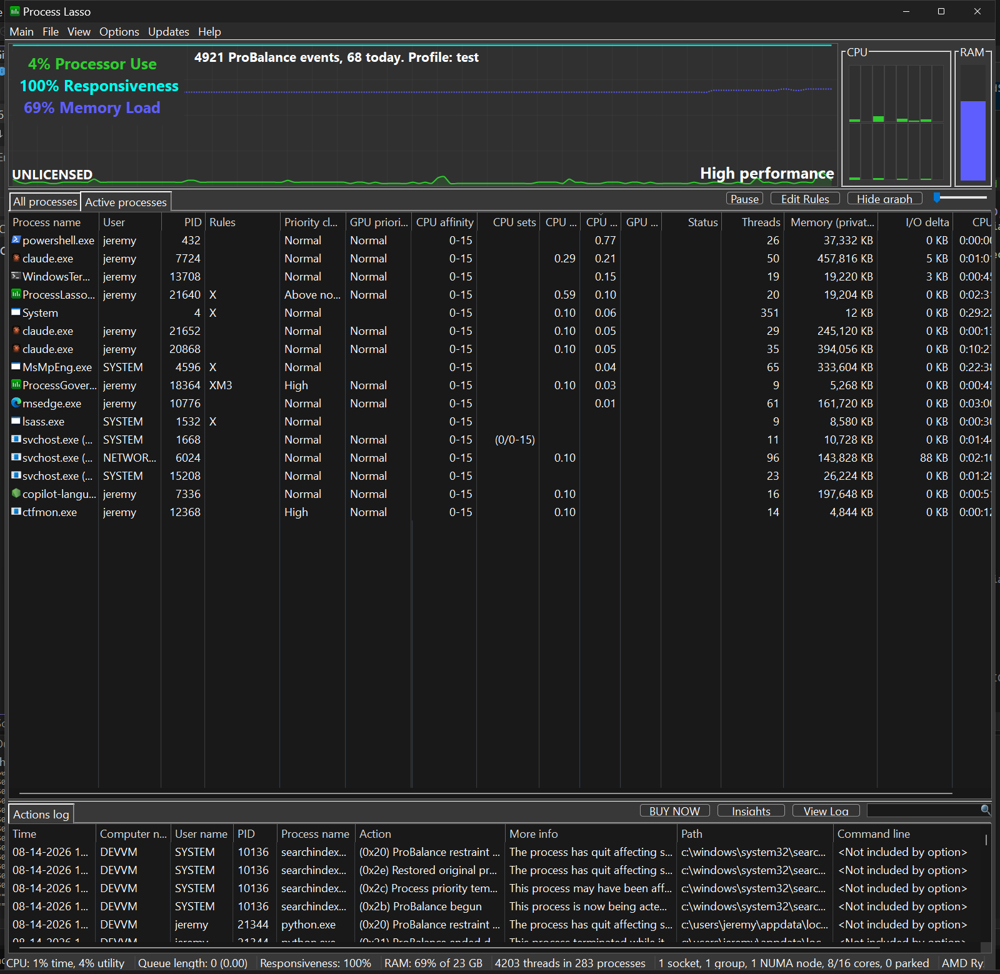
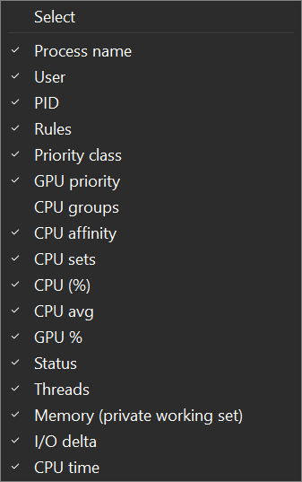
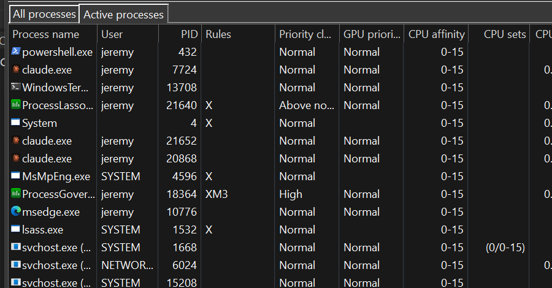

<!-- source: https://bitsum.com/apps/process-lasso/docs/interface/active-processes/ -->

# 活跃进程选项卡

## 选择要显示的列

在「活跃进程」选项卡中，您选择可见列的方式与「所有进程」选项卡相同：右键单击「活跃进程」选项卡，或右键单击列表标题栏。此外，您可以拖动列标题调整列宽（在标题处）并改变列的顺序。这些视图更改会被 Process Lasso 记住。双击「活跃进程」选项卡中的任意进程，会跳转到它在「所有进程」选项卡中的条目，那里有更多可用信息。

活跃进程选项卡

活跃进程选项卡只显示正在积极占用系统 CPU 的进程。它会显示这些进程的基本信息，并用一条水平条形图直观呈现其当前 CPU 使用率。

在「活跃进程」列表中**右键单击**一个或多个进程，会显示与「所有进程」选项卡中[相同的上下文菜单](https://bitsum.com/docs/pl/Using%20the%20GUI/using_the_gui.htm#single_process_context_menu%22)。
**双击**「活跃进程」列表中的进程，会在「所有进程」选项卡中定位对应进程并使其可见。

## 在活跃进程视图中双击进程

您可以双击「活跃进程」选项卡中的进程，跳转到它在「所有进程」选项卡中的条目，那里有扩展信息。

## CPU 使用率纳入阈值滑块

该滑块决定进程需要有多少 CPU 活动才会被列入「活跃进程」选项卡。向右移动会提高阈值，进程需要占用更多 CPU 才能进入列表。滑块最左端为 0.01%，之后每档增加 1%。调整阈值后可能需要几秒钟才会显现效果。
