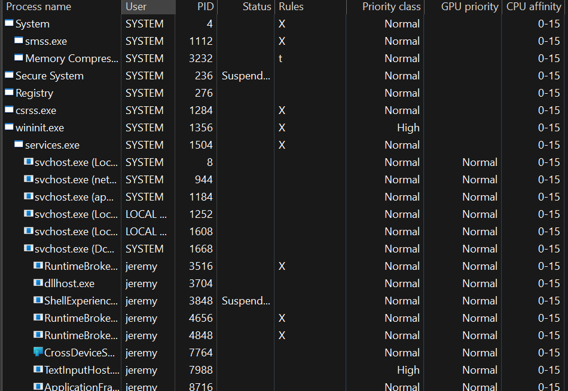
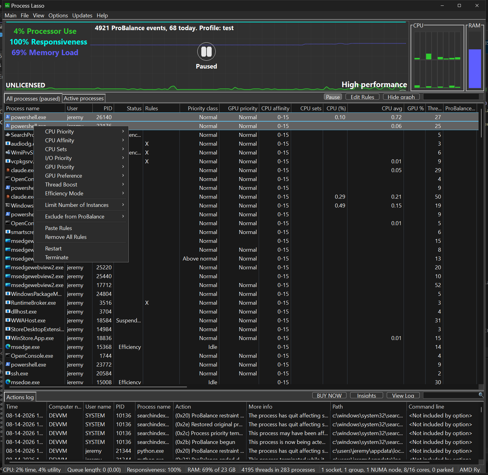

<!-- source: https://bitsum.com/apps/process-lasso/docs/interface/all-processes/ -->

# 所有进程选项卡

进程列表显示正在运行的进程，并便于快速创建规则。您可以右键单击任意进程或多个进程，弹出包含可用选项的上下文菜单。除许多其他功能外，这些选项还包括设置当前优先级与相关性，以及默认优先级与相关性。

## 树状视图

进程树状视图

树状视图提供了一种直观呈现进程父子层级的方式。许多应用程序会派生子进程，导致出现多个同名实例，因此这一新的树状视图让管理它们更容易。它也有助于了解系统状态和特定用户活动。

左键单击「进程名称」列标题，会在树状与经典排序之间切换。左键单击其他任一列会退出树状视图并按该列排序。也可以通过「查看」菜单项切换树状视图。

## 单进程上下文菜单

选中多个进程时的上下文菜单与选中单个进程时不同，因为并非所有操作都能作用于多个进程。

## 多选进程上下文菜单

选择多个进程

使用 Process Lasso，您可以一次选中多个进程并对它们执行操作。选中多个进程时并非所有功能都可用，但大多数常用功能仍然可用。
