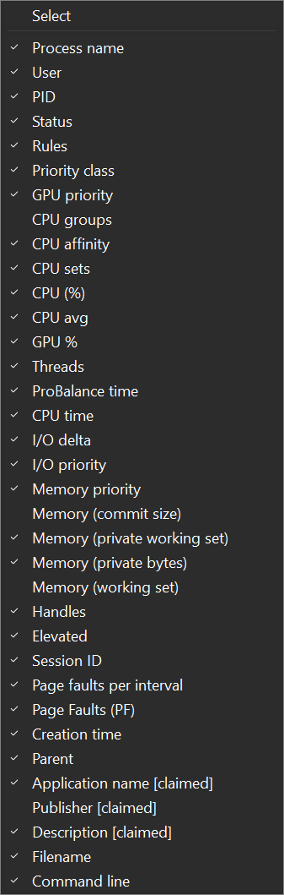

<!-- source: https://bitsum.com/apps/process-lasso/docs/interface/columns/ -->

# 进程信息列

您可以选择显示哪些列：右键单击「所有进程」选项卡、右键单击列表标题栏，或使用「查看 / 选择进程列」菜单。此外，您可以拖动列标题调整列宽（在标题处）并改变列的顺序。这些视图更改会被 Process Lasso 记住。「活跃进程」选项卡同样如此。请注意，右键单击「活跃进程」选项卡可以设置该列中显示的进程信息。「活跃进程」选项卡中的信息比「所有进程」选项卡更有限。不过，双击「活跃进程」选项卡中的任意进程，会跳转到它在「所有进程」选项卡中的条目。

## 规则

进程列表中的「规则」列以简写形式表示每个进程已设置的规则。

格式：`[+|-][X][E|e][L][_][x][W][g][K][#n][d|D][f][p][Mx][t][s][iX][<..<<<<][RHANBI][0-63](0-63)`

| 字符 | 含义 |
| --- | --- |
| + | 动态线程优先级提升：开启 |
| – | 动态线程优先级提升：关闭 |
| X | 已从 ProBalance 排除 |
| E | 效率模式：开启 |
| e | 效率模式：关闭 |
| L | 已限制 CPU |
| \_ | 已做实例均衡 |
| W | 已设置看门狗规则 |
| g | 进程触发性能模式 |
| K | 保持运行（终止后重启） |
| #n | 实例数量限制为 n，例如 #2 表示限制为 2 |
| d | D |
| x | 已从前台提升排除 |
| f | 此进程运行时禁用空闲节能 |
| p | 拥有电源计划规则 |
| M# | 其中「#」为该进程设置的内存优先级。 |
| t | 已从智能内存整理排除 |
| R | 优先级类别：实时 |
| H | 优先级类别：最高 |
| A | 优先级类别：高于正常 |
| N | 优先级类别：正常 |
| B | 优先级类别：低于正常 |
| I | 优先级类别：空闲 |
| ih | I/O 优先级类别：高 |
| in | I/O 优先级类别：正常 |
| il | I/O 优先级类别：低 |
| ib | I/O 优先级类别：很低（后台） |
| 0-63 | CPU 相关性 |
| (0-63) | CPU 集 |
| < | 硬性节流：最低 |
| << | 硬性节流：低 |
| <<< | 硬性节流：中等 |
| <<<< | 硬性节流：高 |

## 状态

可能的值可以是以下项的组合：

- **效率**
  进程正以完整的效率模式运行，即 EcoQOS 加空闲优先级类别。
- **效率（部分）**
  进程正以 EcoQOS 运行，但处于非空闲的优先级类别。
- **已挂起**
  进程已被挂起。在恢复之前，它不会响应用户输入或任何其他东西。用户通常不会手动挂起或恢复进程。UWP 应用程序最常见于挂起状态。
- **受抑制**
  该进程当前正被 ProBalance 处理。它实际上并未受阻，因此性能不会下降；只是其优先级类别被调整，以便系统有足够的 CPU 周期响应可能发生的用户输入。

## ProBalance 时间

该特定进程实例处于 ProBalance 抑制状态的总时长。这*不是*该进程所有历史实例的累计值；若需该数据，请使用「洞察」按钮启动 ProBalance 洞察工具。
