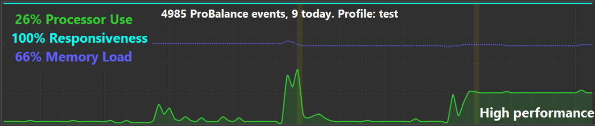
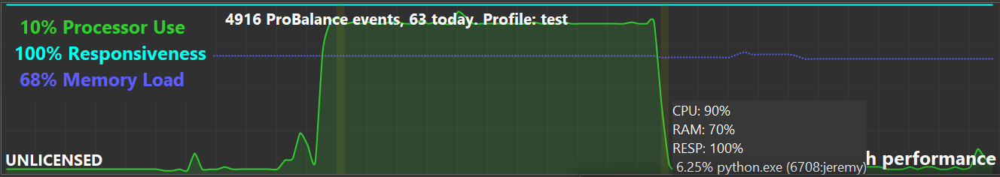
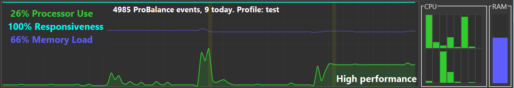
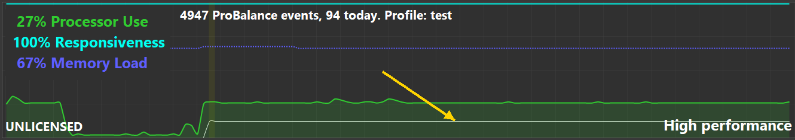

<!-- source: https://bitsum.com/apps/process-lasso/docs/interface/graph/ -->

# 图表

Process Lasso 的图表显示系统响应能力的计算值、整体 CPU 与 GPU 使用率，以及内存负载。系统响应能力由专有算法计算得出，该算法测量用户界面（窗口）子系统中的延迟。

图表中被高亮的部分表示该时段内发生过 ProBalance 的进程抑制动作。这有助于您查看 Process Lasso 对系统响应能力的影响。

## 高亮的 ProBalance 事件

在 ProBalance 采取动作、以确保 CPU 使用量激增时仍维持较高系统响应能力的时段，图表会被高亮。可以查阅日志了解当时执行了哪些操作。

请注意，较新版本中这些颜色是反过来的！

将鼠标悬停在高亮事件上，会显示当时被调整（优先级或 CPU 相关性）的进程。

## GPU 性能数据

GPU 使用率显示在主图表、专用小部件、状态栏以及进程列表中。

由于任何对 GPU 性能数据的检查都会带来*一定*开销，且这一开销往往体现在 ntoskrnl.exe 中，因此只有在 Process Lasso 可见时才会收集这些数据。也正因如此，图表中可能缺少某些时段的 GPU 数据。GPU 使用率报告也可以在「查看 / 图表组件」菜单中完全禁用。

## 所选进程的 CPU 使用率汇总

使用 Process Lasso，您可以查看进程列表中选中进程各自的 CPU 历史。进程列表中当前选中（高亮）的所有进程的 CPU 使用率历史，会以较细的白线绘制在图表上，如箭头所示。在此示例中选中了多个耗 CPU 的进程，因此这条线表示它们的合计 CPU 使用率。

