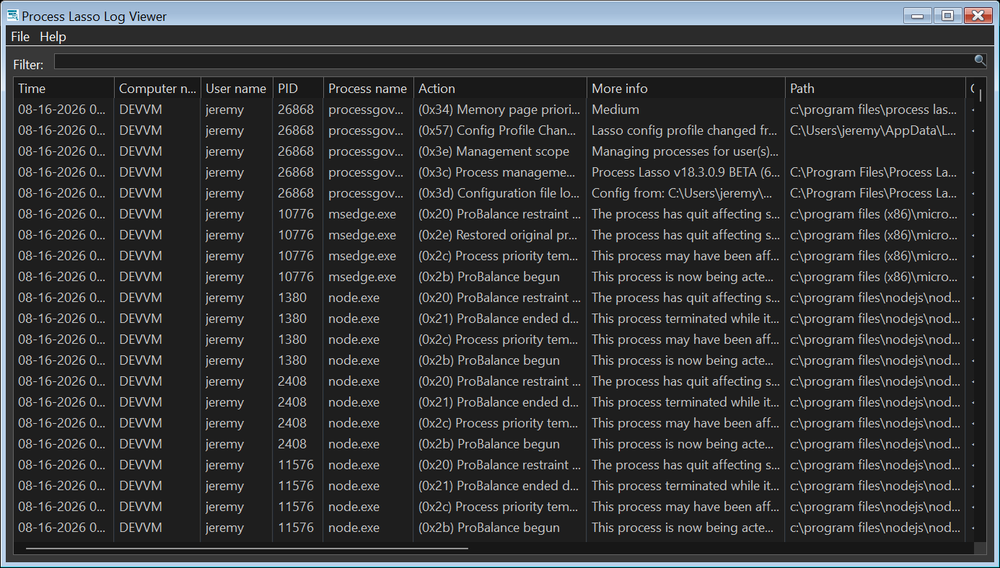
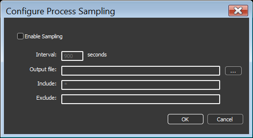

<!-- source: https://bitsum.com/apps/process-lasso/docs/interface/logging/ -->

# 日志记录

Process Lasso 会把自己的操作以及选定的进程事件（例如进程创建与终止）写入 CSV 日志。您可以通过菜单项「选项 / 常规 / 配置启动」调整该日志文件的路径。更多与日志相关的设置位于「选项 / 日志」子菜单。

## 日志查看器

程序内置了专用的日志查看器工具，可在 Process Lasso 下方窗格之外以完整视图打开日志。

Process Lasso 的日志查看器工具

## 进程命令行

默认情况下不记录进程命令行，因为它们可能包含用户敏感信息。勾选菜单项「选项 / 日志 / 包含命令行」即可启用。

## 进程采样（记录指标）

- *菜单路径：「选项 / 日志 / 配置采样」*

进程采样功能可以定期把进程性能数据的快照转储到 CSV。这与 Process Lasso 的主日志不同，主日志记录的是进程创建、终止、规则与算法执行等事件。

Process Lasso 不会对生成的 CSV 文件做轮换或清理，因此启用采样期间它们会无限增长。建议使用下面列出的日期占位符，为不同时段生成不同的日志，再用脚本定期归档或删除较旧的日志。

CSV 输出文件名中的日期时间格式符：

- **%yyyy%** — 4 位年份
- **%MM%** — 月
- **%dd%** — 日
- **%hh%** — 时
- **%mm%** — 分
- **%ss%** — 秒

性能数据的定期快照（采样）
