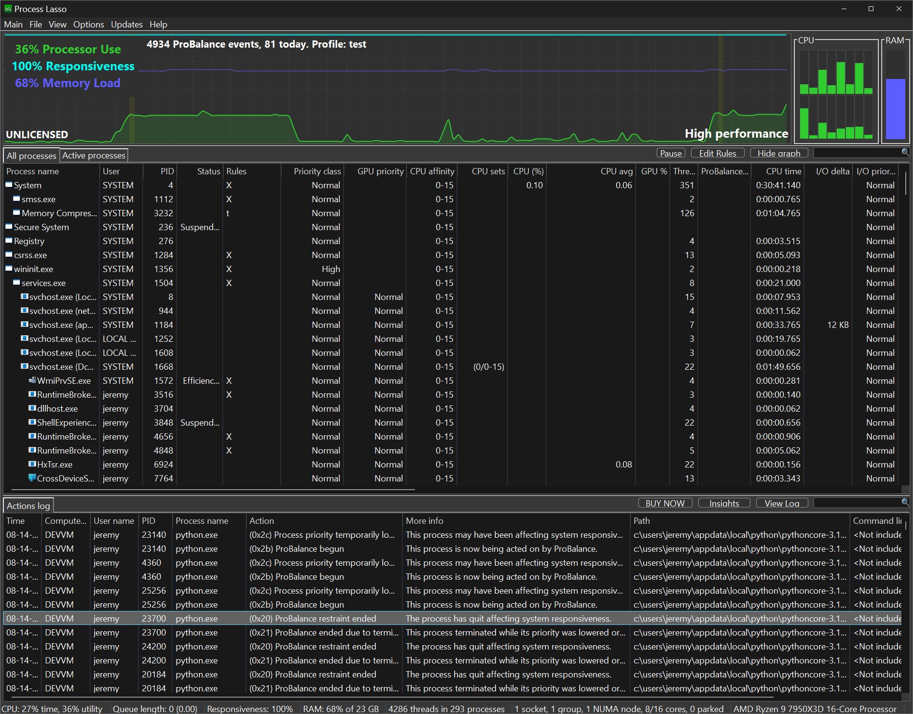
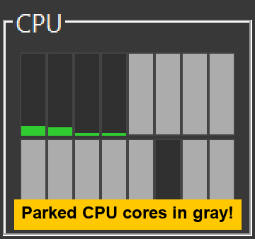

<!-- source: https://bitsum.com/apps/process-lasso/docs/interface/main-window/ -->

# 主窗口

主窗口由 CPU 使用率与系统响应能力图表、正在运行的进程列表，以及近期操作（日志）列表组成。借助菜单系统，Process Lasso 的配置很容易调整。在主菜单中您能找到所有常规配置选项。右键单击某个进程或多个进程，会显示可对它们执行的操作。

以灰色显示的已停放 CPU 核心

