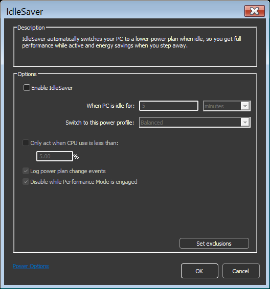

<!-- source: https://bitsum.com/apps/process-lasso/docs/power/idlesaver/ -->

# 空闲节能

- *菜单路径：「选项 / 电源 / 空闲节能 …」*

空闲节能让用户专门为系统空闲时段配置一种电源计划。该功能让用户可以在活跃时段使用高性能电源计划而不必完全放弃节能：当用户空闲时，系统会自动切换到更保守的电源计划。

