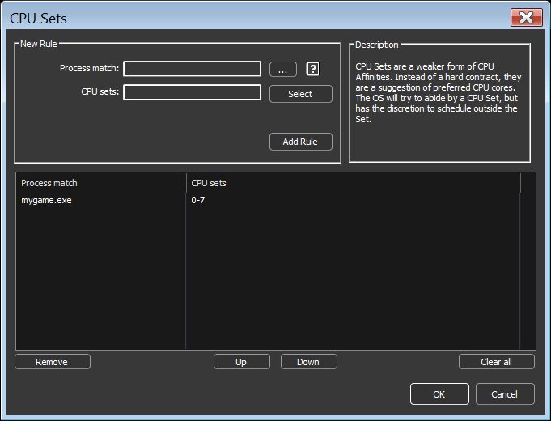
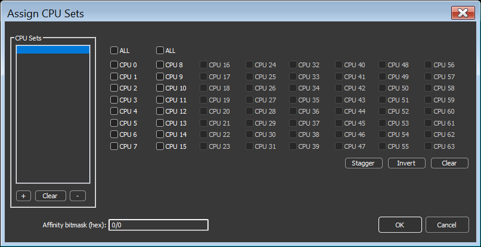

<!-- source: https://bitsum.com/apps/process-lasso/docs/rules/cpu-sets/ -->

# CPU 集

- *菜单路径：「选项 / CPU / CPU 集…」*

[CPU 集](cpu-sets.md#cpusets)是 Windows 的原生功能，属于「更软」的 CPU 相关性形式。它不是硬性约定，而是对首选 CPU 核心的建议。操作系统会尽量遵守 CPU 集，但有权在集之外调度。当线程负载超过集内核心数量，或出于电源管理原因时，这样做是必要的。

相比 CPU 相关性，CPU 集给操作系统的线程调度程序更多灵活性。如果设置了 CPU 集规则的进程需要更多 CPU 来处理线程负载，操作系统可以调度到所分配集之外的 CPU 上。相比之下，CPU 相关性不可被违反，因此该进程的算力会受到限制。所以，进行性能调优时通常优先选用 CPU 集；而要对 CPU 消耗设硬性上限，则应使用传统的 CPU 相关性。

有些应用程序和游戏对 CPU 相关性变化敏感。遇到这些情况，CPU 集是可行的替代方案，因为它更不容易引发问题。

在 Intel 混合架构 CPU（第 12 代酷睿及之后）上，可以用 CPU 集告知操作系统某个进程只使用性能核（P 核）或能效核（E 核），或两者的某种混合。许多用户会发现 CPU 集是为特定应用程序禁用 E 核的理想方式。参见 [Intel 混合架构 CPU：在 P 核与 E 核上调度](https://bitsum.com/intel-hybrid-p-cores-e-cores/)。

在拥有两个 CCD 的 AMD Ryzen X3D CPU 上，「CCD0: cache」与「CCD1: freq」按钮分别选择带或不带 3D V-Cache 的 CCD。参见 [AMD Ryzen X3D CPU：让游戏留在 3D V-Cache CCD 上](https://bitsum.com/amd-x3d-ccd-affinity/)。

在逻辑 CPU 核心超过 64 个、Windows 使用[处理器组](https://bitsum.com/general/the-64-core-threshold-processor-groups-and-windows/)的系统上，进程的 CPU 集可以跨越多个处理器组。因此，您需要为 CPU 集添加*多个*集才能跨越多于一个组。最左侧的列表正是为此准备：使用左侧「CPU 集」列表下方的「+」按钮，然后从右上角的下拉列表中选择另一个处理器组，再从中选择 CPU 以添加第二个 CPU 集。这也是「CPU 集」用复数的原因——您可以指定不止一个集！

Process Lasso 完全支持持久（固定）的 CPU 集。

在 [MSDN 上阅读更多关于 CPU 集的内容](https://docs.microsoft.com/en-us/windows/win32/procthread/cpu-sets)。

CPU 集规则对话框

CPU 集选择对话框
