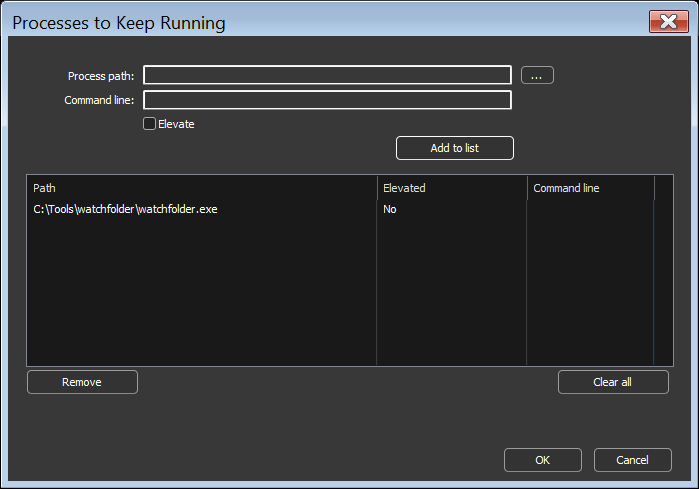
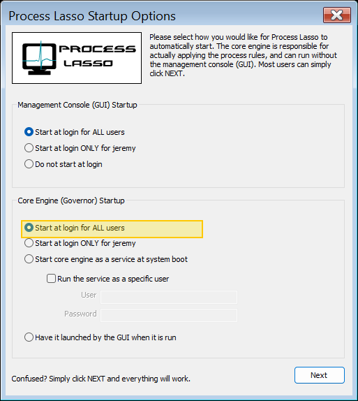

<!-- source: https://bitsum.com/apps/process-lasso/docs/rules/keep-running/ -->

# 保持运行（自动重启）

- *菜单路径：「选项 / 控制 / 保持运行（自动重启）…」*

用户可以在此对话框中登记进程，从而确保某些进程始终保持运行。这样，它们可以在崩溃后重启，或在失去响应后重启。您可以右键单击进程使用「保持进程运行」来设置，也可以使用应用程序菜单中的「选项 / 控制 / 保持运行（自动重启）…」。

## 以进程方式运行 Governor（GaaP）

进程会以 Governor 所在的用户上下文启动。因此，使用保持运行功能时，系统会提示您把 Governor 的启动类型改为普通进程而非服务。若希望被启动的进程在用户会话中交互，您应当这样做。

若想手动把 Governor 的启动类型改为 GaaP，请打开菜单项「选项 / 常规 / 配置启动」，并在第一个对话框底部把 Governor 的部署类型选为「为所有用户在其登录时启动」。若之后想改回服务方式，请选择「在系统启动时以服务方式启动核心引擎」。

把 Governor 部署为普通进程

## 被启动进程的提升权限

作为安全加固的一部分，Process Lasso 启动的任何进程都以非提升权限运行，除非您事先设置了[注册表选项](https://dl2.bitsum.com/files/pl_enable_elevated_launches.zip)以提升权限启动它们。
