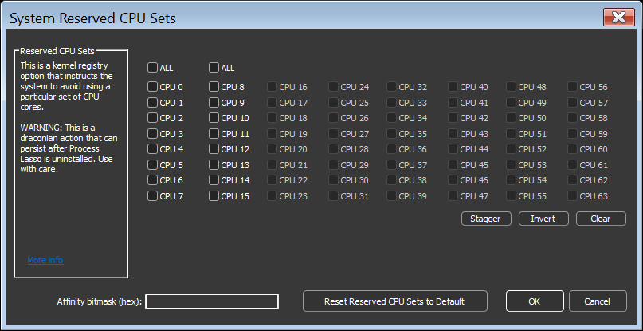
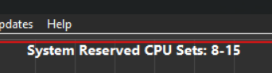

<!-- source: https://bitsum.com/apps/process-lasso/docs/rules/reserved-cpu-sets/ -->

# 系统保留 CPU 集

- *菜单路径：「工具 / 系统保留 CPU 集」*

系统保留 CPU 集是一项内核注册表选项，它指示系统避开某组特定的 CPU 核心，您可以随后把这些核心专门留给实时应用使用。与按进程生效的 [CPU 集](cpu-sets.md#cpusets)规则不同，该设置作用于整个系统。

警告：这是一个相当激烈的动作，即便卸载 Process Lasso 之后也可能依然生效（不过届时会提示您移除它）。此外，可能存在应用程序不兼容的情况，而同时包含保留核心与非保留核心的 CPU 相关性规则也可能引发问题。

由于您保留了一部分核心，该设置会使系统无法充分利用这些 CPU 核心。此外，该设置会禁用保留 CPU 核心的核心停放。

更改此设置后需要重启系统。

我们建议先尝试其他功能，再考虑调整这项内核选项——哪怕只是为了规避这个值被设置后遗忘、从而永久影响系统性能的可能。

系统保留 CPU 集工具

当设置了系统保留 CPU 集的值时，Process Lasso 会在图表上显示它。

图表上显示的系统保留 CPU 集
