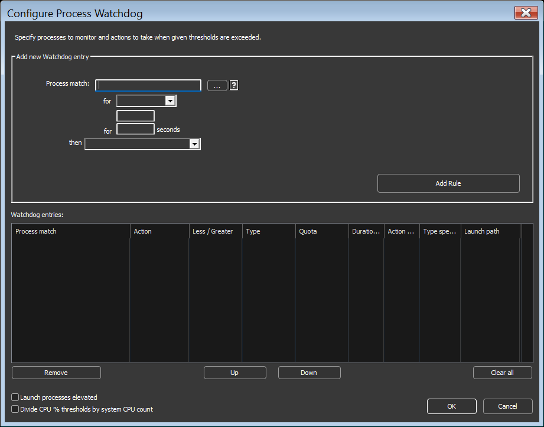

<!-- source: https://bitsum.com/apps/process-lasso/docs/rules/watchdog/ -->

# 进程看门狗

- *菜单路径：「选项 / 控制 / 看门狗（高级规则） …」*

进程看门狗（「如果…则…」规则）让您可以在进程超过一定量的 CPU 或内存占用时对其执行动作。您可以指定重启、终止、记录日志、执行（外部程序）或更改相关性等动作。对于内存与 CPU 触发条件，都可以设置进程必须超过该阈值多久才会执行动作。

有多种动作与触发类型。

## 触发条件

- CPU
- 内存

## 动作

- 更改 CPU 相关性
- 执行
- 记录发生情况
- 重启进程
- 设置 CPU 优先级类别
- 设置 I/O 优先级类别
- 停止处理规则
- 终止进程
- 整理虚拟内存

## 选项

- ***将 CPU % 阈值除以系统 CPU 数***
  把 CPU 阈值除以逻辑核心总数。例如可以填写 3200%，除以 64 个核心后即为总 CPU 使用率的 50% 阈值。这在核心数较多的系统上能获得更高的精度。

该功能支持[正则表达式，用于更复杂精确的匹配](../reference/process-matching.md#processmatch)。
